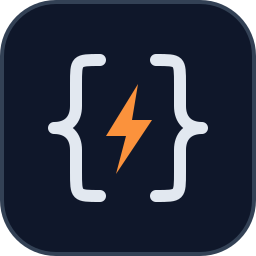

# neojson

**An nlohmann-compatible C++ JSON API on top of yyjson.**

---

An implementation of the `nlohmann::ordered_json` API on top of yyjson's parser. The library has one value type,
`neojson::json`: an owned node tree with nlohmann's semantics (objects keep the order of insertion, integers are
signed or unsigned, and so on) that `json::parse` fills from yyjson's parse of the text. Differential tests against
nlohmann/json are the specification. Work in progress.

License: MIT. yyjson (vendor/yyjson) is MIT licensed.

## Limits

`json::parse` and `json::accept` accept arrays and objects nested up to 1100 levels deep (`json::parse_options::default_max_depth`). A document nested deeper is a `parse_error` (id 120, "nesting limit exceeded"), a discarded value when exceptions are off, and `false` from `accept`. Pass a `json::parse_options` as the last argument to change the limit for one call: `json::parse(text, nullptr, true, false, json::parse_options{256})` or `json::accept(text, false, json::parse_options{256})`. Parsing and destroying a tree need no deep call stack, however deep the tree is, including a tree that a program built without parsing. Copying, dumping and comparing a tree with `==` or `<` recurse once per level, as they do in nlohmann/json, so they need stack in proportion to the depth: a thread with a small stack should use a smaller limit, or avoid those calls on a very deep tree.

## Compatibility Notes

- **Container allocator types (`array_t`, `object_t`)**: For allocation performance, `neojson::json::array_t` is `std::vector<json, neojson::detail::pool_allocator<json>>` and `neojson::json::object_t` uses `neojson::detail::pool_allocator`. Value conversions (`json(std::vector<json>)`, `j.get<std::vector<json>>()`) still compile and work, but code ported from `nlohmann::ordered_json` that binds or requests exact standard-allocator container types (`get_ptr<const std::vector<json>*>()`, `get_ref<std::vector<json>&>()`, `swap(std::vector<json>&)`, `const std::vector<json>&`) must use `json::array_t` / `json::object_t`.
- **Lazy/COW parsing and `const` references**: `json::parse` returns a lazy DOM backed by a shared immutable `yyjson` document, and copies share backing storage copy-on-write:
  - Prefer `std::as_const` for read-only traversal on shared values; non-`const` `operator[]`, `at`, or `find` detaches and clones every touched container level.
  - As with other implicitly-shared containers, references, pointers, or iterators obtained through `const` access to shared storage become invalid if any holder sharing that storage mutates and detaches while shared. This includes single-statement expressions such as `j["a"] = std::as_const(j)["b"];` when `j` shares storage; copy the value first (`json tmp = std::as_const(j)["b"]; j["a"] = std::move(tmp);`) or call `j.materialize()` beforehand.
  - Any live unmaterialized lazy descendant pins the underlying `yyjson` document; call `j.materialize()` to greedily detach a subtree into standalone owned storage.
- **`constexpr` / `noexcept` differences**: `get_ptr` for `const object_t*` and `const array_t*` is not `constexpr`. Queries marked `noexcept` (`size()`, `clear()`, `get_ptr()`, `==`, `<`) on unmaterialized lazy containers may allocate during on-demand materialization and call `std::terminate` on out-of-memory.
