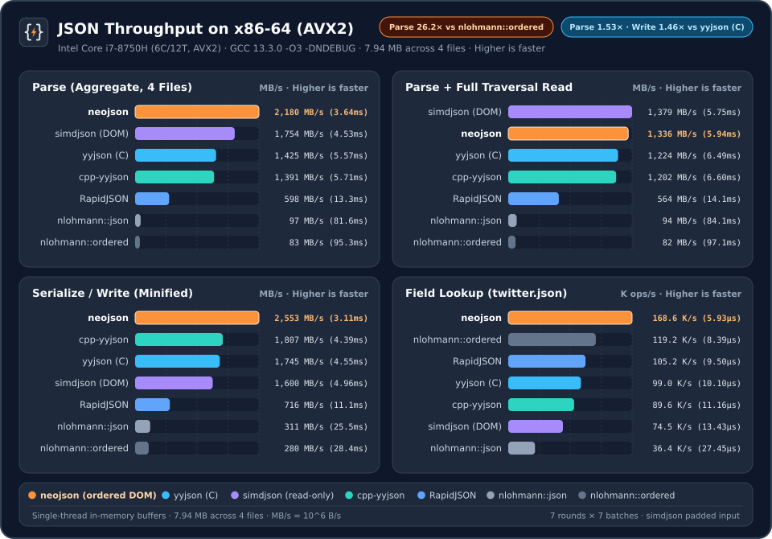

<div align="center">


# neojson

**An nlohmann-compatible C++ JSON API combining native AVX2/NEON/SWAR SIMD parsers, vendored yyjson, and a lazy COW DOM.**

[](https://github.com/fox1245/neojson/actions/workflows/ci.yml)
[](LICENSE)
[](CMakeLists.txt)

</div>

---

An implementation of the `nlohmann::ordered_json` API combining native x86-64 AVX2 and ARM64 NEON SIMD parsers (with vendored `yyjson` fallback on unsupported targets and small/comment/BOM inputs) and a lazy Copy-on-Write DOM. The library exposes one value type, `neojson::json`: an owned node tree with nlohmann's semantics (objects keep the order of insertion, integers are signed or unsigned, and so on) that materializes lazily from the flat parsed document. Differential tests against nlohmann/json are the specification. Work in progress.

License: MIT. yyjson (vendor/yyjson) is MIT licensed.

## Benchmarks

Single-thread in-memory throughput across the standard 4-file JSON benchmark corpus (`canada.json`, `citm_catalog.json`, `gsoc-2018.json`, `twitter.json`; `7.94 MB` total, median of 7 alternating rounds × 7 batches, GCC 13.3.0 `-O3 -DNDEBUG`, no `-march=native`, C++20 benchmark harnesses with `libneojson` built as C++17 per root `CMakeLists.txt`).

On x86-64 AVX2 (`Intel Core i7-8750H`), `neojson` parses **30.8× faster** than `nlohmann::ordered_json`, **1.84× faster** than the `yyjson` C API, and **1.44× faster** than `simdjson` DOM, while also leading Parse + Full Read (**1.26×** vs `yyjson`), Write (**1.42×**), and Field Lookup (**1.66×**). On ARM64 NEON (`ARM Neoverse-N1`), with its native NEON SIMD parser backend, `neojson` parses **30.9× faster** than `nlohmann::ordered_json`, **1.47× faster** than `yyjson` C, and **1.44× faster** than `simdjson` DOM (`1,685` vs `1,171 MB/s`), while leading Parse + Full Read (**1,074 MB/s**), Write (**1.28×**), and Field Lookup (**1.25×**).



| Architecture / CPU | Workload | `neojson` | `yyjson (C)` | `simdjson` (DOM) | `cpp-yyjson` | `RapidJSON` | `nlohmann::json` | `nlohmann::ordered` |
|---|---|---|---|---|---|---|---|---|
| **x86-64 AVX2**<br>Intel Core i7-8750H | Parse (4 files) | **2,557 MB/s** (`3.10 ms`) | 1,393 MB/s | 1,779 MB/s | 1,382 MB/s | 599 MB/s | 96 MB/s | 83 MB/s |
| | Parse + Full Read | **1,498 MB/s** (`5.30 ms`) | 1,189 MB/s | 1,404 MB/s | 1,196 MB/s | 564 MB/s | 94 MB/s | 81 MB/s |
| | Write (Minified) | **2,574 MB/s** (`3.08 ms`) | 1,810 MB/s | 1,604 MB/s | 1,755 MB/s | 716 MB/s | 277 MB/s | 321 MB/s |
| | Mutable Build | 2,442 MB/s (`3.25 ms`) | 3,962 MB/s | — *(read-only)* | 4,180 MB/s | **5,215 MB/s** | 360 MB/s | 233 MB/s |
| | Field Lookup (`twitter.json`) | **161.0 K/s** (`6.21 µs`) | 97.3 K/s | 76.2 K/s | 88.5 K/s | 105.4 K/s | 37.1 K/s | 123.6 K/s |
| **ARM64 NEON**<br>ARM Neoverse-N1 | Parse (4 files) | **1,685 MB/s** (`4.71 ms`) | 1,145 MB/s | 1,171 MB/s | 1,145 MB/s | 445 MB/s | 63 MB/s | 55 MB/s |
| | Parse + Full Read | **1,074 MB/s** (`7.39 ms`) | 975 MB/s | 967 MB/s | 1,005 MB/s | 421 MB/s | 61 MB/s | 54 MB/s |
| | Write (Minified) | **1,705 MB/s** (`4.66 ms`) | 1,336 MB/s | 1,080 MB/s | 1,341 MB/s | 561 MB/s | 257 MB/s | 264 MB/s |
| | Mutable Build | 1,692 MB/s (`4.69 ms`) | 3,422 MB/s | — *(read-only)* | 3,160 MB/s | **4,157 MB/s** | 243 MB/s | 168 MB/s |
| | Field Lookup (`twitter.json`) | **122.2 K/s** (`8.18 µs`) | 98.2 K/s | 63.7 K/s | 80.4 K/s | 96.4 K/s | 49.0 K/s | 106.8 K/s |

### Why is `neojson` faster than `yyjson` (C)?

1. **Native AVX2/NEON/SWAR parsers + pooled buffers (`1.84×` parse on x86-64, `1.47×` on ARM64)**: For standard inputs (`>= 32 B`, no comments/BOM), `json::parse()` bypasses `yyjson_read()` and dispatches an arch-neutral native SIMD parser core (`Avx2ParserOps` on x86-64 AVX2 and `NeonParserOps` on ARM64 NEON), featuring SIMD whitespace/string/Keiser-Lemire UTF-8 scanning, SWAR 8-digit integer & fractional float parsing, Eisel-Lemire multipliers, and tight coordinate-pair runs into a `yyjson_doc`-compatible layout backed by bounded thread-local caches (`ThreadLargeCache`, configurable via `set_thread_cache_limits()` / `trim_thread_caches()`), avoiding per-parse `malloc`/`free`.
2. **Lazy COW DOM + direct `DocArena` traversal (`1.26×` read x86-64, `1.10×` ARM64)**: `json::parse()` wraps the flat parsed document in a 16-byte lazy handle instead of allocating per-node containers up front. Read-only traversal materializes compact bump-allocated `DocArena` views with shape caching (`ArenaShapeCache`), fast string interning (`LongStrInternCache`), and portable object-run builders — outperforming both `yyjson (C)` and `simdjson (DOM)` on full-traversal `Parse + Read` across both architectures.
3. **Flat direct serializer into `std::string` (`1.42×` write x86-64, `1.28×` ARM64)**: Unmaterialized lazy documents serialize straight into the caller's `std::string` via an 8 KiB staging buffer, input-size reserve hint, `YYJSON_SUBTYPE_NOESC` fast paths, numeric-pair coordinate runs, and AVX2 escape scanning on x86-64 — avoiding `yyjson_write()`'s `malloc` + copy + `free` cycle and caching object key uniqueness after first inspection.
4. **Contiguous keys + open-addressed indexing & compact DOM builders (`1.66×` lookup x86-64, `1.25×` ARM64)**: Unlike `yyjson`'s flat preorder object scan (`O(N)`), `ArenaObject` stores keys contiguously and builds an open-addressed `ArenaHashIndex` lazily above 16 keys (`kOrderedMapHashThreshold`), while mutable `json` containers use compact `SmallArray2`/`SmallObject4` slabs with NEON/SSE2 tag scanning and single-probe `ordered_map` indexing (`10.5×` / `10.1×` faster build than `nlohmann::ordered_json` on x86-64 / ARM64).

See [docs/benchmarks.md](docs/benchmarks.md) for the ARM64 NEON chart, full per-file breakdown chart and tables, methodology notes (`simdjson` pre-padded DOM, `RapidJSON` baseline SIMD flags), and reproduction commands under [`bench/`](bench/).

## Examples

Runnable C++17 examples are listed in [examples/README.md](examples/README.md) (`NEOJSON_BUILD_EXAMPLES` defaults to `OFF` so downstream `FetchContent` consumers do not build examples unless requested):

```bash
cmake -S . -B build -DCMAKE_BUILD_TYPE=Release -DNEOJSON_BUILD_EXAMPLES=ON
cmake --build build --parallel
ctest --test-dir build -R "^example_" --output-on-failure
```

## Limits

`json::parse` and `json::accept` accept arrays and objects nested up to 1100 levels deep (`json::parse_options::default_max_depth`). A document nested deeper is a `parse_error` (id 120, "nesting limit exceeded"), a discarded value when exceptions are off, and `false` from `accept`. Pass a `json::parse_options` as the last argument to change the limit for one call: `json::parse(text, nullptr, true, false, json::parse_options{256})` or `json::accept(text, false, json::parse_options{256})`. Parsing and destroying a tree need no deep call stack, however deep the tree is, including a tree that a program built without parsing. Copying, dumping and comparing a tree with `==` or `<` recurse once per level, as they do in nlohmann/json, so they need stack in proportion to the depth: a thread with a small stack should use a smaller limit, or avoid those calls on a very deep tree.

### Thread-Local Caches

For throughput, `neojson` caches parsed large buffers (`ThreadLargeCache`, up to 16 MiB per entry and 24 MiB total per thread by default), empty 64 KiB slabs (`max_cached_empty_slabs`, default `64`), string/key buffers (`enable_string_pool`, default `true`), and per-thread materialization scratch buffers until the thread exits. Long-lived worker pools that occasionally handle large payloads can release idle thread-local caches explicitly or tighten process-wide budgets:

- `neojson::trim_thread_caches() noexcept`: flushes deferred document refcount credits, clears materialization scratch/string caches, frees all cached large buffers, and returns unused 64 KiB slabs on the calling thread while preserving live `json` values (safe no-op on untouched threads).
- `neojson::get_thread_cache_limits() noexcept` / `neojson::set_thread_cache_limits(const neojson::thread_cache_limits&) noexcept`: inspects or updates `large_cache_max_entry_bytes`, `large_cache_max_total_bytes`, `max_cached_empty_slabs`, and `enable_string_pool`, immediately trimming the calling thread to the new limits.

## Compatibility Notes

- **Container allocator types (`array_t`, `object_t`)**: For allocation performance, `neojson::json::array_t` is `std::vector<json, neojson::detail::pool_allocator<json>>` and `neojson::json::object_t` uses `neojson::detail::pool_allocator`. Value conversions (`json(std::vector<json>)`, `j.get<std::vector<json>>()`) still compile and work, but code ported from `nlohmann::ordered_json` that binds or requests exact standard-allocator container types (`get_ptr<const std::vector<json>*>()`, `get_ref<std::vector<json>&>()`, `swap(std::vector<json>&)`, `const std::vector<json>&`) must use `json::array_t` / `json::object_t`.
- **Lazy/COW parsing, `SharedString`, and `const` references**: `json::parse` returns a lazy DOM backed by a shared immutable `yyjson` document, and copies share backing containers and string payloads (`detail::SharedString`) copy-on-write:
  - Prefer `std::as_const` for read-only traversal on shared values; non-`const` `operator[]`, `at`, `find`, or `get_ptr<string_t*>`/`get_ref<string_t&>` detaches shared storage as needed.
  - Non-`const` `get_ptr<string_t*>()` and `get_ref<string_t&>()` pin the string as unshareable (`refcount == 0`) so later copies clone eagerly and cannot alias mutations through the obtained mutable handle.
  - As with other implicitly-shared containers, references, pointers, or iterators obtained through `const` access to shared storage become invalid if any holder sharing that storage mutates and detaches while shared. This includes single-statement expressions such as `j["a"] = std::as_const(j)["b"];` when `j` shares storage; copy the value first (`json tmp = std::as_const(j)["b"]; j["a"] = std::move(tmp);`) or call `j.materialize()` beforehand.
  - Any live unmaterialized lazy descendant pins the underlying `yyjson` document; call `j.materialize()` to greedily detach all containers and shared strings in a subtree into standalone owned storage.
- **Floating-point `dump()` formatting**: Finite doubles serialize via vendored `yyjson` Schubfach shortest IEEE-754 round-trip formatting using `nlohmann`-compatible fixed/scientific bounds (`-4 < dot_ofs <= 15`) and signed two-digit padded exponents (`e+XX` / `e-XX`). Output always round-trips bit-exact to the original `double` and is never longer than Grisu2, though individual boundary floats may differ cleanly in shortest decimal digits from older `nlohmann::json` versions.
- **`constexpr` / `noexcept` differences**: `get_ptr` for `const object_t*` and `const array_t*` is not `constexpr`. Queries marked `noexcept` (`size()`, `clear()`, `get_ptr()`, `==`, `<`) on shared or unmaterialized storage may allocate during on-demand materialization or COW string detach (`get_ptr<string_t*>()`, `clear()` on a shared string) and call `std::terminate` on out-of-memory.
