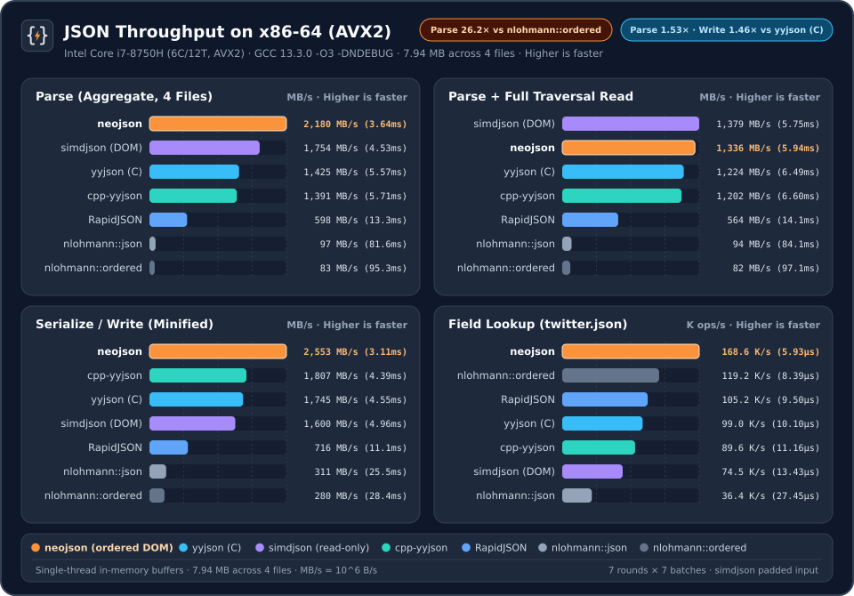
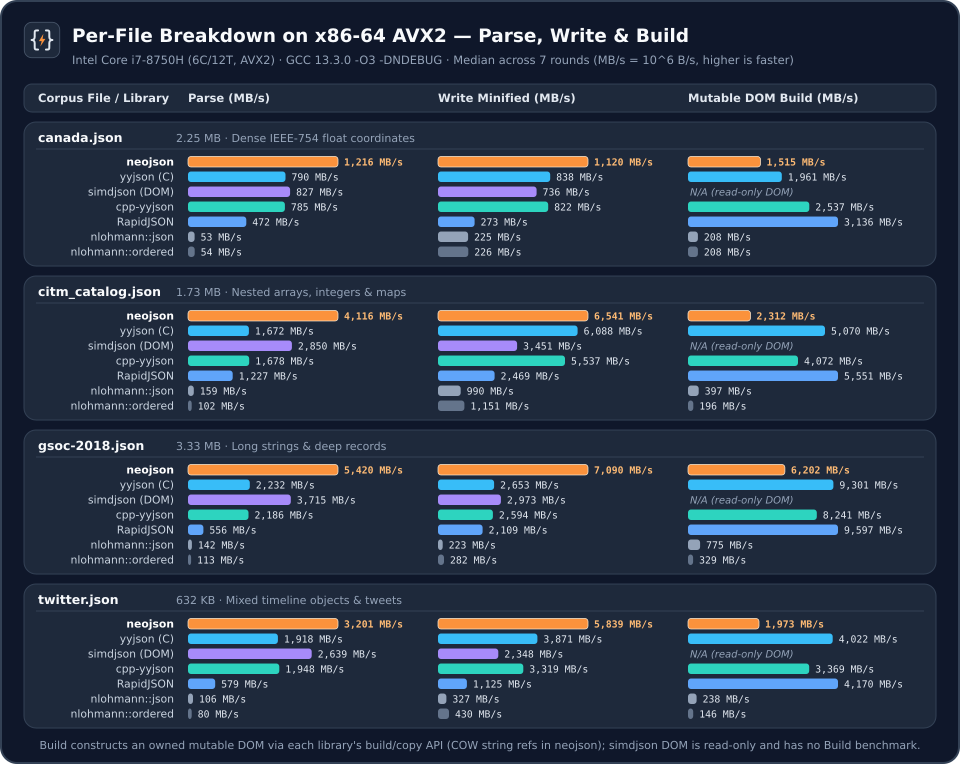
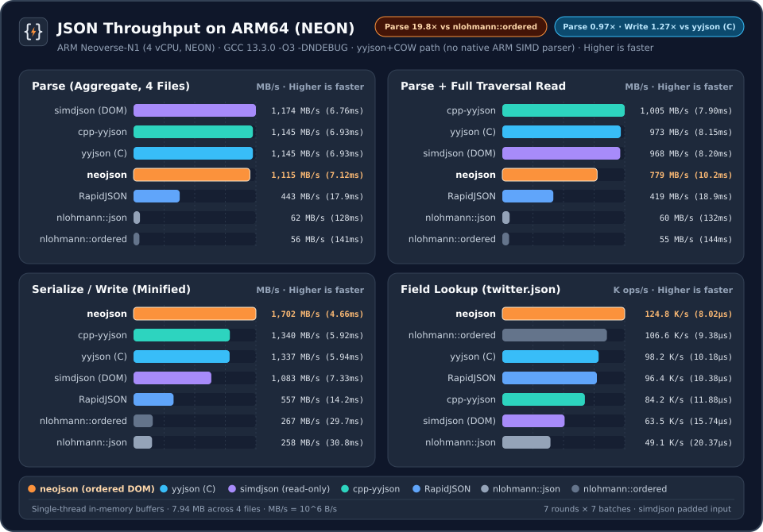

# Cross-Architecture JSON Benchmarks

Reproducible single-thread benchmarks comparing `neojson` against six widely used C and C++ JSON libraries on two CPU architectures: **x86-64 (AVX2)** and **ARM64 (NEON)**.

All benchmark binaries live under [`bench/`](../bench/), compile with identical optimization flags (`-O3 -DNDEBUG`, no LTO, no `-march=native`; C++20 benchmark harnesses with `libneojson` built as C++17 per root `CMakeLists.txt`), verify output parity across all 7 libraries via `--verify` before timing, and report the median across **7 alternating paired rounds × 7 measured batches** (>= 25 ms per batch). Throughput uses SI megabytes (`MB/s = 10^6 bytes/s`), and ratios in tables show median latency relative to the `yyjson (C)` baseline (lower ratio = faster; higher `MB/s` or `K/s` = faster).

## Competitor Lineup & Versions

| Target Binary | Library & Version | DOM / Execution Model | Notes |
|---|---|---|---|
| `bench_neojson` | **`neojson`** (vendored `yyjson` v0.13.0) | Ordered mutable DOM (`C++17`/`C++20`) | Insertion-ordered keys, copy-on-write string/node storage, AVX2 structural scanner on x86-64 |
| `bench_yyjson` | `yyjson` v0.13.0 | Immutable/mutable C DOM | Pure C API baseline (`yyjson_read`, `yyjson_write`, `yyjson_mut_doc`) |
| `bench_simdjson` | `simdjson` v5.3.0 | Read-only tape DOM | Pre-padded `simdjson::padded_string` (padding copy excluded from timed loop), reused `dom::parser`; mutable build N/A |
| `bench_cppyyjson` | `cpp-yyjson` v2.1.0 | Ordered DOM wrapper | Linked against the same vendored `yyjson` v0.13.0 static library |
| `bench_rapidjson` | `RapidJSON` (`297637bc`) | Mutable DOM | Header-only include; baseline SIMD explicitly enabled (`RAPIDJSON_SSE2` on x86-64, `RAPIDJSON_NEON` on ARM64) |
| `bench_nlohmann_json` | `nlohmann::json` v3.11.3 | Unordered mutable DOM | Standard single-header `nlohmann::json` (`std::map`) |
| `bench_nlohmann_ordered` | `nlohmann::ordered_json` v3.11.3 | Ordered mutable DOM | Nearest semantic peer (`nlohmann::fifo_map` insertion order) |

## Corpus (`bench/corpus.json`)

Total corpus size: **7,937,600 B (7.94 MB)**. Each file's SHA-256 digest is verified at configure time by `bench/CMakeLists.txt`.

| File | Size | Workload Profile | SHA-256 Prefix |
|---|---|---|---|
| `canada.json` | 2,251,051 B (2.25 MB) | Dense IEEE-754 float coordinates | `f83b3b354030d5dd...` |
| `citm_catalog.json` | 1,727,204 B (1.73 MB) | Nested arrays, integers & maps | `a73e7a883f6ea8de...` |
| `gsoc-2018.json` | 3,327,831 B (3.33 MB) | Long strings & deep records | `72f1ef4898d88049...` |
| `twitter.json` | 631,514 B (632 KB) | Mixed timeline objects & tweets | `a08b769f32b95f42...` |

## Test Environments

| Architecture | CPU | Logical CPUs | Compiler & Flags | Build Type |
|---|---|---|---|---|
| **x86-64 (AVX2)** | Intel Core i7-8750H (AVX2) | 12 | GCC 13.3.0 (`-O3 -DNDEBUG`, C++20 harnesses / C++17 `libneojson`) | Portable Release (no LTO, no `-march=native`) |
| **ARM64 (NEON)** | ARM Neoverse-N1 (AArch64 NEON) | 4 | GCC 13.3.0 (`-O3 -DNDEBUG`, C++20 harnesses / C++17 `libneojson`) | Portable Release (no LTO, no `-march=native`) |

---

## x86-64 (AVX2) Results



### Aggregate Throughput & Latency (x86-64 AVX2)

Each cell reports `throughput (median time, ratio vs yyjson C)`. Ratios `< 1.00×` are faster than C `yyjson`.

| Workload | `neojson` | `yyjson` (C) | `simdjson` (DOM) | `cpp-yyjson` | `RapidJSON` | `nlohmann::json` | `nlohmann::ordered` |
|---|---|---|---|---|---|---|---|
| Parse (Aggregate, 4 files) | **2,180 MB/s (3.64ms, 0.65×)** | 1,425 MB/s (5.57ms, 1.00×) | 1,754 MB/s (4.53ms, 0.81×) | 1,391 MB/s (5.71ms, 1.02×) | 598 MB/s (13.3ms, 2.38×) | 97 MB/s (81.6ms, 14.65×) | 83 MB/s (95.3ms, 17.12×) |
| Parse + Full Traversal Read (4 files) | 1,336 MB/s (5.94ms, 0.92×) | 1,224 MB/s (6.49ms, 1.00×) | **1,379 MB/s (5.75ms, 0.89×)** | 1,202 MB/s (6.60ms, 1.02×) | 564 MB/s (14.1ms, 2.17×) | 94 MB/s (84.1ms, 12.97×) | 82 MB/s (97.1ms, 14.97×) |
| Serialize / Write Minified (4 files) | **2,553 MB/s (3.11ms, 0.68×)** | 1,745 MB/s (4.55ms, 1.00×) | 1,600 MB/s (4.96ms, 1.09×) | 1,807 MB/s (4.39ms, 0.97×) | 716 MB/s (11.1ms, 2.44×) | 311 MB/s (25.5ms, 5.61×) | 280 MB/s (28.4ms, 6.24×) |
| Mutable DOM Build (4 files) | 2,530 MB/s (3.14ms, 1.63×) | 4,129 MB/s (1.92ms, 1.00×) | — *(read-only)* | 4,034 MB/s (1.97ms, 1.02×) | **5,177 MB/s (1.53ms, 0.80×)** | 353 MB/s (22.5ms, 11.71×) | 224 MB/s (35.4ms, 18.43×) |
| Field Lookup (`twitter.json`) | **168.6 K/s (5.93 µs, 0.59×)** | 99.0 K/s (10.10 µs, 1.00×) | 74.5 K/s (13.43 µs, 1.33×) | 89.6 K/s (11.16 µs, 1.10×) | 105.2 K/s (9.50 µs, 0.94×) | 36.4 K/s (27.45 µs, 2.72×) | 119.2 K/s (8.39 µs, 0.83×) |

### Per-File Breakdown (x86-64 AVX2)



| Workload | File | Size | `neojson` | `yyjson` (C) | `simdjson` (DOM) | `cpp-yyjson` | `RapidJSON` | `nlohmann::json` | `nlohmann::ordered` |
|---|---|---|---|---|---|---|---|---|---|
| `parse` | `canada.json` | 2.25 MB | **939 MB/s (2,398 µs, 0.87×)** | 816 MB/s (2,758 µs, 1.00×) | 813 MB/s (2,769 µs, 1.00×) | 790 MB/s (2,850 µs, 1.03×) | 472 MB/s (4,773 µs, 1.73×) | 54 MB/s (41,629 µs, 15.09×) | 54 MB/s (41,708 µs, 15.12×) |
| `parse` | `citm_catalog.json` | 1.73 MB | **4,143 MB/s (417 µs, 0.42×)** | 1,748 MB/s (988 µs, 1.00×) | 2,815 MB/s (614 µs, 0.62×) | 1,673 MB/s (1,032 µs, 1.04×) | 1,226 MB/s (1,409 µs, 1.43×) | 160 MB/s (10,765 µs, 10.89×) | 100 MB/s (17,205 µs, 17.41×) |
| `parse` | `gsoc-2018.json` | 3.33 MB | **5,297 MB/s (628 µs, 0.42×)** | 2,207 MB/s (1,508 µs, 1.00×) | 3,694 MB/s (901 µs, 0.60×) | 2,226 MB/s (1,495 µs, 0.99×) | 555 MB/s (5,993 µs, 3.97×) | 143 MB/s (23,326 µs, 15.47×) | 117 MB/s (28,524 µs, 18.91×) |
| `parse` | `twitter.json` | 632 KB | **3,188 MB/s (198 µs, 0.63×)** | 2,008 MB/s (314 µs, 1.00×) | 2,601 MB/s (243 µs, 0.77×) | 1,915 MB/s (330 µs, 1.05×) | 578 MB/s (1,092 µs, 3.47×) | 108 MB/s (5,847 µs, 18.60×) | 80 MB/s (7,908 µs, 25.15×) |
| `read` | `canada.json` | 2.25 MB | 633 MB/s (3,555 µs, 1.04×) | **657 MB/s (3,427 µs, 1.00×)** | 632 MB/s (3,563 µs, 1.04×) | 650 MB/s (3,463 µs, 1.01×) | 425 MB/s (5,299 µs, 1.55×) | 52 MB/s (43,247 µs, 12.62×) | 52 MB/s (42,922 µs, 12.52×) |
| `read` | `citm_catalog.json` | 1.73 MB | **2,229 MB/s (775 µs, 0.69×)** | 1,534 MB/s (1,126 µs, 1.00×) | 2,056 MB/s (840 µs, 0.75×) | 1,465 MB/s (1,179 µs, 1.05×) | 1,114 MB/s (1,550 µs, 1.38×) | 155 MB/s (11,155 µs, 9.90×) | 99 MB/s (17,474 µs, 15.51×) |
| `read` | `gsoc-2018.json` | 3.33 MB | 2,764 MB/s (1,204 µs, 0.77×) | 2,120 MB/s (1,570 µs, 1.00×) | **3,262 MB/s (1,020 µs, 0.65×)** | 2,125 MB/s (1,566 µs, 1.00×) | 547 MB/s (6,081 µs, 3.87×) | 141 MB/s (23,553 µs, 15.00×) | 116 MB/s (28,706 µs, 18.28×) |
| `read` | `twitter.json` | 632 KB | 1,553 MB/s (407 µs, 1.12×) | 1,739 MB/s (363 µs, 1.00×) | **1,906 MB/s (331 µs, 0.91×)** | 1,604 MB/s (394 µs, 1.08×) | 548 MB/s (1,153 µs, 3.18×) | 103 MB/s (6,149 µs, 16.93×) | 79 MB/s (8,004 µs, 22.04×) |
| `write` | `canada.json` | 2.25 MB | **1,065 MB/s (2,113 µs, 0.77×)** | 819 MB/s (2,749 µs, 1.00×) | 734 MB/s (3,065 µs, 1.12×) | 838 MB/s (2,688 µs, 0.98×) | 273 MB/s (8,247 µs, 3.00×) | 229 MB/s (9,831 µs, 3.58×) | 225 MB/s (10,026 µs, 3.65×) |
| `write` | `citm_catalog.json` | 1.73 MB | **6,543 MB/s (264 µs, 0.83×)** | 5,427 MB/s (318 µs, 1.00×) | 3,462 MB/s (499 µs, 1.57×) | 6,067 MB/s (285 µs, 0.89×) | 2,467 MB/s (700 µs, 2.20×) | 1,101 MB/s (1,569 µs, 4.93×) | 985 MB/s (1,754 µs, 5.51×) |
| `write` | `gsoc-2018.json` | 3.33 MB | **5,416 MB/s (614 µs, 0.48×)** | 2,583 MB/s (1,288 µs, 1.00×) | 2,950 MB/s (1,128 µs, 0.88×) | 2,645 MB/s (1,258 µs, 0.98×) | 2,111 MB/s (1,577 µs, 1.22×) | 268 MB/s (12,415 µs, 9.64×) | 225 MB/s (14,758 µs, 11.45×) |
| `write` | `twitter.json` | 632 KB | **5,396 MB/s (117 µs, 0.61×)** | 3,274 MB/s (193 µs, 1.00×) | 2,345 MB/s (269 µs, 1.40×) | 3,871 MB/s (163 µs, 0.85×) | 1,127 MB/s (560 µs, 2.90×) | 375 MB/s (1,685 µs, 8.74×) | 345 MB/s (1,833 µs, 9.50×) |
| `build` | `canada.json` | 2.25 MB | 1,508 MB/s (1,492 µs, 1.50×) | 2,261 MB/s (996 µs, 1.00×) | — | 2,513 MB/s (896 µs, 0.90×) | **3,114 MB/s (723 µs, 0.73×)** | 201 MB/s (11,197 µs, 11.24×) | 198 MB/s (11,394 µs, 11.44×) |
| `build` | `citm_catalog.json` | 1.73 MB | 2,255 MB/s (766 µs, 2.04×) | 4,597 MB/s (376 µs, 1.00×) | — | 3,870 MB/s (446 µs, 1.19×) | **5,546 MB/s (311 µs, 0.83×)** | 396 MB/s (4,361 µs, 11.61×) | 186 MB/s (9,264 µs, 24.66×) |
| `build` | `gsoc-2018.json` | 3.33 MB | 6,094 MB/s (546 µs, 1.45×) | 8,834 MB/s (377 µs, 1.00×) | — | 7,841 MB/s (424 µs, 1.13×) | **9,578 MB/s (347 µs, 0.92×)** | 775 MB/s (4,297 µs, 11.41×) | 323 MB/s (10,312 µs, 27.37×) |
| `build` | `twitter.json` | 632 KB | 1,897 MB/s (333 µs, 1.91×) | 3,621 MB/s (174 µs, 1.00×) | — | 3,138 MB/s (201 µs, 1.15×) | **4,170 MB/s (151 µs, 0.87×)** | 238 MB/s (2,650 µs, 15.19×) | 141 MB/s (4,464 µs, 25.59×) |
| `lookup` | `twitter.json` | 632 KB | **168.6 K/s (5.93 µs, 0.59×)** | 99.0 K/s (10.10 µs, 1.00×) | 74.5 K/s (13.43 µs, 1.33×) | 89.6 K/s (11.16 µs, 1.10×) | 105.2 K/s (9.50 µs, 0.94×) | 36.4 K/s (27.45 µs, 2.72×) | 119.2 K/s (8.39 µs, 0.83×) |

---

## ARM64 (NEON) Results

> **Architecture note:** `neojson`'s x86 AVX2 parser is guarded by `#define NEOJSON_X86_SIMD 0` on `__aarch64__` (`src/json.cpp`), so ARM64 currently exercises the portable scalar `yyjson` + COW ordered-DOM path (whereas `simdjson` executes its native ARM64 NEON kernels). Even without native ARM SIMD parsing yet, `neojson` parses within **2.5%** of C `yyjson` (`1,115 MB/s` vs `1,145 MB/s`, **19.8× faster** than `nlohmann::ordered_json`), leads minified serialization (**1,702 MB/s**, **1.27×** vs `yyjson`), and leads `twitter.json` field lookup (**124.8 K/s**, `8.02 µs`).



### Aggregate Throughput & Latency (ARM64 NEON)

| Workload | `neojson` | `yyjson` (C) | `simdjson` (DOM) | `cpp-yyjson` | `RapidJSON` | `nlohmann::json` | `nlohmann::ordered` |
|---|---|---|---|---|---|---|---|
| Parse (Aggregate, 4 files) | 1,115 MB/s (7.12ms, 1.03×) | 1,145 MB/s (6.93ms, 1.00×) | **1,174 MB/s (6.76ms, 0.98×)** | 1,145 MB/s (6.93ms, 1.00×) | 443 MB/s (17.9ms, 2.58×) | 62 MB/s (128ms, 18.47×) | 56 MB/s (141ms, 20.33×) |
| Parse + Full Traversal Read (4 files) | 779 MB/s (10.2ms, 1.25×) | 973 MB/s (8.15ms, 1.00×) | 968 MB/s (8.20ms, 1.01×) | **1,005 MB/s (7.90ms, 0.97×)** | 419 MB/s (18.9ms, 2.32×) | 60 MB/s (132ms, 16.18×) | 55 MB/s (144ms, 17.62×) |
| Serialize / Write Minified (4 files) | **1,702 MB/s (4.66ms, 0.79×)** | 1,337 MB/s (5.94ms, 1.00×) | 1,083 MB/s (7.33ms, 1.23×) | 1,340 MB/s (5.92ms, 1.00×) | 557 MB/s (14.2ms, 2.40×) | 258 MB/s (30.8ms, 5.19×) | 267 MB/s (29.7ms, 5.01×) |
| Mutable DOM Build (4 files) | 1,670 MB/s (4.75ms, 2.05×) | 3,421 MB/s (2.32ms, 1.00×) | — *(read-only)* | 3,096 MB/s (2.56ms, 1.11×) | **4,137 MB/s (1.92ms, 0.83×)** | 240 MB/s (33.1ms, 14.27×) | 168 MB/s (47.2ms, 20.33×) |
| Field Lookup (`twitter.json`) | **124.8 K/s (8.02 µs, 0.79×)** | 98.2 K/s (10.18 µs, 1.00×) | 63.5 K/s (15.74 µs, 1.55×) | 84.2 K/s (11.88 µs, 1.17×) | 96.4 K/s (10.38 µs, 1.02×) | 49.1 K/s (20.37 µs, 2.00×) | 106.6 K/s (9.38 µs, 0.92×) |

### Per-File Breakdown (ARM64 NEON)

| Workload | File | Size | `neojson` | `yyjson` (C) | `simdjson` (DOM) | `cpp-yyjson` | `RapidJSON` | `nlohmann::json` | `nlohmann::ordered` |
|---|---|---|---|---|---|---|---|---|---|
| `parse` | `canada.json` | 2.25 MB | 639 MB/s (3,524 µs, 1.01×) | 645 MB/s (3,490 µs, 1.00×) | 611 MB/s (3,681 µs, 1.05×) | **647 MB/s (3,480 µs, 1.00×)** | 415 MB/s (5,426 µs, 1.55×) | 39 MB/s (57,672 µs, 16.52×) | 40 MB/s (56,746 µs, 16.26×) |
| `parse` | `citm_catalog.json` | 1.73 MB | 1,557 MB/s (1,109 µs, 1.06×) | 1,650 MB/s (1,047 µs, 1.00×) | **1,666 MB/s (1,037 µs, 0.99×)** | 1,650 MB/s (1,047 µs, 1.00×) | 781 MB/s (2,210 µs, 2.11×) | 90 MB/s (19,173 µs, 18.32×) | 68 MB/s (25,412 µs, 24.28×) |
| `parse` | `gsoc-2018.json` | 3.33 MB | 1,603 MB/s (2,075 µs, 1.04×) | 1,663 MB/s (2,001 µs, 1.00×) | **2,069 MB/s (1,609 µs, 0.80×)** | 1,656 MB/s (2,009 µs, 1.00×) | 383 MB/s (8,700 µs, 4.35×) | 80 MB/s (41,498 µs, 20.74×) | 70 MB/s (47,786 µs, 23.88×) |
| `parse` | `twitter.json` | 632 KB | 1,551 MB/s (407 µs, 1.03×) | **1,590 MB/s (397 µs, 1.00×)** | 1,448 MB/s (436 µs, 1.10×) | 1,589 MB/s (397 µs, 1.00×) | 398 MB/s (1,586 µs, 3.99×) | 65 MB/s (9,757 µs, 24.57×) | 57 MB/s (11,042 µs, 27.80×) |
| `read` | `canada.json` | 2.25 MB | 487 MB/s (4,626 µs, 1.06×) | 514 MB/s (4,383 µs, 1.00×) | 494 MB/s (4,556 µs, 1.04×) | **549 MB/s (4,102 µs, 0.94×)** | 374 MB/s (6,011 µs, 1.37×) | 38 MB/s (59,684 µs, 13.62×) | 38 MB/s (58,637 µs, 13.38×) |
| `read` | `citm_catalog.json` | 1.73 MB | 1,048 MB/s (1,648 µs, 1.36×) | **1,422 MB/s (1,214 µs, 1.00×)** | 1,338 MB/s (1,291 µs, 1.06×) | 1,404 MB/s (1,230 µs, 1.01×) | 722 MB/s (2,392 µs, 1.97×) | 85 MB/s (20,272 µs, 16.69×) | 67 MB/s (25,815 µs, 21.26×) |
| `read` | `gsoc-2018.json` | 3.33 MB | 1,050 MB/s (3,168 µs, 1.51×) | 1,586 MB/s (2,098 µs, 1.00×) | **1,831 MB/s (1,817 µs, 0.87×)** | 1,585 MB/s (2,099 µs, 1.00×) | 375 MB/s (8,877 µs, 4.23×) | 80 MB/s (41,616 µs, 19.84×) | 69 MB/s (47,997 µs, 22.88×) |
| `read` | `twitter.json` | 632 KB | 841 MB/s (751 µs, 1.64×) | **1,378 MB/s (458 µs, 1.00×)** | 1,187 MB/s (532 µs, 1.16×) | 1,358 MB/s (465 µs, 1.01×) | 382 MB/s (1,654 µs, 3.61×) | 61 MB/s (10,370 µs, 22.63×) | 56 MB/s (11,199 µs, 24.43×) |
| `write` | `canada.json` | 2.25 MB | **757 MB/s (2,973 µs, 0.79×)** | 599 MB/s (3,756 µs, 1.00×) | 459 MB/s (4,901 µs, 1.30×) | 601 MB/s (3,748 µs, 1.00×) | 218 MB/s (10,334 µs, 2.75×) | 199 MB/s (11,308 µs, 3.01×) | 197 MB/s (11,416 µs, 3.04×) |
| `write` | `citm_catalog.json` | 1.73 MB | **5,414 MB/s (319 µs, 0.82×)** | 4,445 MB/s (389 µs, 1.00×) | 2,776 MB/s (622 µs, 1.60×) | 4,449 MB/s (388 µs, 1.00×) | 1,372 MB/s (1,259 µs, 3.24×) | 678 MB/s (2,549 µs, 6.56×) | 717 MB/s (2,410 µs, 6.20×) |
| `write` | `gsoc-2018.json` | 3.33 MB | **2,729 MB/s (1,219 µs, 0.78×)** | 2,129 MB/s (1,563 µs, 1.00×) | 2,292 MB/s (1,452 µs, 0.93×) | 2,137 MB/s (1,557 µs, 1.00×) | 1,736 MB/s (1,917 µs, 1.23×) | 239 MB/s (13,907 µs, 8.90×) | 243 MB/s (13,692 µs, 8.76×) |
| `write` | `twitter.json` | 632 KB | **4,168 MB/s (152 µs, 0.66×)** | 2,754 MB/s (229 µs, 1.00×) | 1,771 MB/s (357 µs, 1.56×) | 2,744 MB/s (230 µs, 1.00×) | 854 MB/s (739 µs, 3.22×) | 206 MB/s (3,058 µs, 13.34×) | 286 MB/s (2,206 µs, 9.62×) |
| `build` | `canada.json` | 2.25 MB | 994 MB/s (2,265 µs, 1.87×) | 1,854 MB/s (1,214 µs, 1.00×) | — | 1,849 MB/s (1,218 µs, 1.00×) | **2,756 MB/s (817 µs, 0.67×)** | 159 MB/s (14,119 µs, 11.63×) | 164 MB/s (13,762 µs, 11.34×) |
| `build` | `citm_catalog.json` | 1.73 MB | 1,569 MB/s (1,101 µs, 2.50×) | 3,921 MB/s (441 µs, 1.00×) | — | 3,147 MB/s (549 µs, 1.25×) | **4,527 MB/s (382 µs, 0.87×)** | 242 MB/s (7,145 µs, 16.22×) | 136 MB/s (12,700 µs, 28.83×) |
| `build` | `gsoc-2018.json` | 3.33 MB | 3,852 MB/s (864 µs, 1.86×) | **7,152 MB/s (465 µs, 1.00×)** | — | 6,070 MB/s (548 µs, 1.18×) | 6,410 MB/s (519 µs, 1.12×) | 504 MB/s (6,601 µs, 14.19×) | 222 MB/s (14,963 µs, 32.16×) |
| `build` | `twitter.json` | 632 KB | 1,209 MB/s (523 µs, 2.61×) | **3,154 MB/s (200 µs, 1.00×)** | — | 2,530 MB/s (250 µs, 1.25×) | 3,140 MB/s (201 µs, 1.00×) | 121 MB/s (5,235 µs, 26.14×) | 110 MB/s (5,740 µs, 28.66×) |
| `lookup` | `twitter.json` | 632 KB | **124.8 K/s (8.02 µs, 0.79×)** | 98.2 K/s (10.18 µs, 1.00×) | 63.5 K/s (15.74 µs, 1.55×) | 84.2 K/s (11.88 µs, 1.17×) | 96.4 K/s (10.38 µs, 1.02×) | 49.1 K/s (20.37 µs, 2.00×) | 106.6 K/s (9.38 µs, 0.92×) |

---

## Methodology & Fairness Details

1. **Process & Symbol Isolation**: `bench/CMakeLists.txt` builds seven independent executables (`bench_neojson`, `bench_yyjson`, `bench_simdjson`, `bench_cppyyjson`, `bench_rapidjson`, `bench_nlohmann_json`, `bench_nlohmann_ordered`) so no binary ever links two copies of `yyjson` or shares allocator/global state across libraries.
2. **Header-Only `RapidJSON` Fetch**: Upstream `RapidJSON`'s `CMakeLists.txt` injects `-march=native` and `-Werror` into global compiler flags. `bench/CMakeLists.txt` downloads and unpacks `RapidJSON`'s headers directly so every benchmark binary compiles under identical `-O3 -DNDEBUG` rules, with `RAPIDJSON_SSE2` defined on x86-64 and `RAPIDJSON_NEON` defined on ARM64.
3. **`simdjson` Padded Input & Read-Only Scope**: `bench/bench.cpp` pre-allocates a reusable `simdjson::padded_string` and `simdjson::dom::parser` per benchmark call (so padding copies do not penalize parse throughput). Because `simdjson::dom` is a read-only tape parser rather than a mutable DOM, `build` is omitted (`N/A`) rather than emulated.
4. **Mutable DOM Build Semantics (`build`)**: Each mutable library constructs a fresh DOM document from a pre-parsed reference document — using builder/insertion APIs (`obj[key] = ...`, `yyjson_mut_obj_add`, `cpp_yyjson` constructors/builders) for `neojson`, `yyjson`, `cpp-yyjson`, and `nlohmann`, and `Document::CopyFrom(doc, alloc, true)` for `RapidJSON`. In `neojson`, copying parsed string leaves increments internal `SharedString` copy-on-write reference counts rather than copying raw string bytes (`RapidJSON`, `yyjson (C)`, and `cpp-yyjson` still lead `build` throughput on both architectures).
5. **Cross-Library Verification Gate (`--verify`)**: `python3 bench/run.py --verify` checks that all 7 executables return identical element counts, scalar checksums, `twitter.json` field lookup matches (`8,284` hits), minified write round-trip verification (`true`), and mutable build round-trip verification before timing runs are collected.

## Reproducing Locally

```bash
cmake -S bench -B build-bench -DCMAKE_BUILD_TYPE=Release
cmake --build build-bench --parallel
python3 bench/run.py --build build-bench --verify
python3 bench/run.py --build build-bench --rounds 7 --json results.json
```
